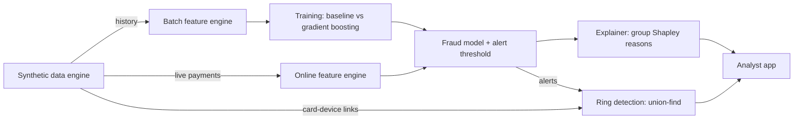

# FraudLens

**Real-time, explainable card fraud detection.**
FraudLens scores every card payment the moment it happens, flags the suspicious ones and
explains *why* each one was flagged, so a fraud analyst can act on it in seconds.

[](https://fraudlens-begum.streamlit.app)


**Live demo: [fraudlens-begum.streamlit.app](https://fraudlens-begum.streamlit.app)**

---

## What it does


| Screen | What it shows |
|---|---|
| **Live monitor** | Unseen payments replayed in time order through the real-time path. Attacks punch through the alert line as red spikes, and each alert says why it fired. |
| **Test a payment** | Describe a new payment for a real customer and get the decision and its reasons instantly. |
| **Attack simulator** | Launch a fresh attack on any card and see at which payment it is caught and how much money is saved. |
| **Fraud rings** | Cards linked through shared devices, rings told apart from families, and the shop where the card details leaked. |
| **Model performance** | Baseline vs gradient boosting, with a slider for the false-alarm budget. |

The app needs no data or model files: on launch it generates its own bank of 2,000
customers and trains the model. More screenshots are in [`docs/screenshots`](docs/screenshots).

## Results

Evaluated on 651,379 synthetic payments (5,000 customers, 60 days), split by time, with
the alert threshold fixed at **at most 1 false alarm per 1,000 genuine payments**.
Test set: 130,510 payments, 173 fraudulent, 29 separate attacks.

| Model | PR-AUC | Fraud caught | £ fraud caught | Attacks caught |
|---|---:|---:|---:|---:|
| Logistic regression (baseline) | 0.850 | 91.9% | 90.4% | 29 / 29 |
| **Gradient boosting** | **0.970** | **98.3%** | **98.7%** | **29 / 29** |

| Live step, one payment | p50 |
|---|---:|
| Features (online engine) | 0.06 ms |
| Model score | 7 ms |
| Plain-English explanation | 15 ms |

Fraud rings, using only alerts the model was not trained on: **7 of 8** rings and **55 of
62** victim cards found, **no** family wrongly called a ring, and the breached shop
ranked first for **all 7** rings found.

## Why it is hard

Card fraud is rare (well under 1% of payments) but expensive, and a bank has only a few
milliseconds to decide whether to approve a payment. That makes it a hard engineering
problem, not just a modelling one:

- **Extreme class imbalance**: a model that says "never fraud" is 99.7% accurate and useless.
- **Time matters**: features such as "how many payments in the last 10 minutes" must be
  computed from the past only, otherwise the model cheats (data leakage).
- **Decisions must be explainable**: analysts and regulators need a reason, not just a score.
- **Latency budget**: scoring has to be fast enough to sit inside a payment flow.

## How it works



- **Data**: a generator of customers with individual habits, three real-world attack
  types, fraud rings working from a breached shop, and hard negatives (genuine travel,
  families sharing a laptop). [Details](docs/data-and-features.md)
- **Features**: 24 velocity, habit, location, device and network features, built only from
  each card's past, by two engines (batch for training, online for live scoring) that a
  test proves agree. [Details](docs/data-and-features.md#features)
- **Model**: time-based split, threshold set from a false-alarm budget, judged on money
  and attacks caught, not just accuracy. [Details](docs/model.md)
- **Explanations**: exact Shapley values over feature groups, turned into sentences such as
  *"Online payment from a device never used with this card before"*. [Details](docs/explainability.md)
- **Fraud rings**: a union-find written from scratch links cards through shared devices;
  model alerts separate rings from families; the victims' history points to the breached
  shop. [Details](docs/fraud-rings.md)

## What I got wrong, and fixed

- **The explanations exposed a shortcut.** Card-testing alerts were explained by "abroad +
  digital goods", not by the burst of tiny payments: the model would have missed testers
  using a UK VPN. I fixed the generator and retrained. [More](docs/explainability.md)
- **A collapsed baseline was a preprocessing bug.** My first guess (shared family devices)
  was disproved by an ablation; log-transforming skewed features took the baseline from
  0.29 to 0.85 PR-AUC. [More](docs/model.md#a-hypothesis-i-got-wrong)
- **The "network" feature adds nothing.** It looked like the perfect ring signal, but
  retraining without it gives the same results: ring devices are always new to the card,
  which the model already catches. The rings are exposed by the graph, not by this
  feature. [More](docs/fraud-rings.md#a-second-hypothesis-i-got-wrong)

**Limitations.** The data is synthetic, so attacks are cleaner than real fraud, and 29 test
attacks make "29 / 29" encouraging rather than proof. The evaluation method (time split,
fixed false-alarm budget, money- and attack-level recall) carries over unchanged to real data.

## Roadmap

- [x] Synthetic data engine, point-in-time features, model comparison
- [x] Explainable alerts and the analyst app
- [x] Fraud-ring detection with a hand-written union-find
- [ ] Drift monitoring: detect when a new attack pattern degrades the model
- [ ] Scoring API: FastAPI service with measured p50 / p99 latency

## Quick start

```bash
git clone https://github.com/beggumuzun/fraudlens.git
cd fraudlens
python -m venv .venv && source .venv/bin/activate
pip install -e ".[dev]"

# 1. generate the dataset (the results above use exactly these settings)
fraudlens-generate --customers 5000 --days 60 --out data/transactions.csv

# 2. build features (also prints a fraud-vs-genuine report)
fraudlens-features --input data/transactions.csv --out data/features.csv

# 3. train and compare models (saves models/fraudlens.joblib and reports/metrics.json)
fraudlens-train --features data/features.csv

# 4. explain the alerts on the test period (writes reports/explanations.json)
fraudlens-explain --features data/features.csv

# 5. find fraud rings and the shops their card details leaked from (reports/rings.json)
fraudlens-rings --transactions data/transactions.csv --features data/features.csv

# 6. does the network feature help? retrain without it (reports/ablation.json)
fraudlens-ablation --features data/features.csv

# 7. time each live step for one payment (reports/benchmark.json)
fraudlens-bench --transactions data/transactions.csv --features data/features.csv

# 8. open the analyst app (builds its own demo world, no files needed)
fraudlens-app

# run tests and lint
pytest -v
ruff check .
```

## Project structure

```
fraudlens/
├── src/fraudlens/
│   ├── data/
│   │   ├── entities.py    # cities, categories, customers, merchants
│   │   ├── scenarios.py   # fraud attacks and genuine travel
│   │   └── generator.py   # builds the dataset, CLI, live replay
│   ├── features/
│   │   ├── definitions.py # feature names, constants, shared maths
│   │   ├── batch.py       # vectorised engine for training + CLI
│   │   └── online.py      # per-payment engine for live scoring
│   ├── model/
│   │   ├── split.py       # train / validation / test by time
│   │   ├── metrics.py     # false-alarm budget, £ recall, attack recall
│   │   ├── train.py       # baseline vs gradient boosting, save model + CLI
│   │   └── ablation.py    # retrain without one feature and compare
│   ├── explain/
│   │   ├── reasons.py     # group Shapley values -> plain-English reasons
│   │   └── cli.py         # explain test-period alerts
│   ├── graph/
│   │   ├── union_find.py  # disjoint-set union, written from scratch
│   │   ├── rings.py       # linked groups, rings vs families, point of compromise
│   │   └── cli.py         # ring report
│   ├── bench.py           # latency of each live step
│   └── app/
│       ├── world.py       # demo world: data, model, warmed-up live engine
│       ├── main.py        # navigation and layout
│       └── views/         # live monitor, test a payment, simulator, rings, performance
├── streamlit_app.py       # entry point for Streamlit Community Cloud
├── docs/                  # detailed write-ups and screenshots
├── reports/               # metrics, explanations, rings, ablation, benchmark
├── tests/                 # pytest suite, run on every push by GitHub Actions
└── pyproject.toml
```

## Author

**Begüm Uzun**, BSc Computer Science, UWE Bristol
[LinkedIn](https://www.linkedin.com/in/beggum-uzun) · [GitHub](https://github.com/beggumuzun)
