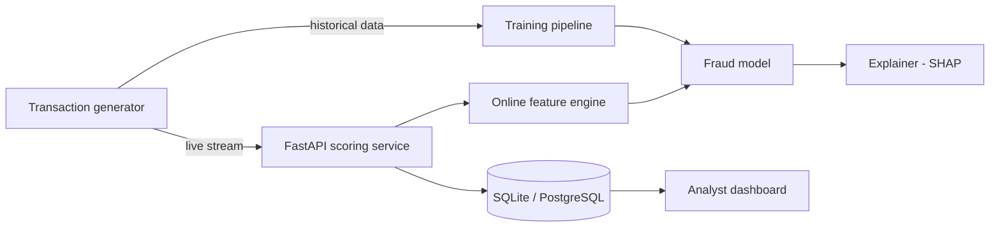

# FraudLens

**Real-time, explainable card fraud detection.**
FraudLens scores every card payment the moment it happens, flags the suspicious ones and
explains *why* each one was flagged, so a fraud analyst can act on it in seconds.


> Work in progress. See the [roadmap](#roadmap) for what is built so far.

---

## Why this project

Card fraud is rare (well under 1% of payments) but expensive, and a bank has only a few
milliseconds to decide whether to approve a payment. That makes it a hard engineering
problem, not just a modelling one:

- **Extreme class imbalance**: a model that says "never fraud" is 99.7% accurate and useless.
- **Time matters**: features such as "how many payments in the last 10 minutes" must be
  computed from the past only, otherwise the model cheats (data leakage).
- **Decisions must be explainable**: analysts and regulators need a reason, not just a score.
- **Latency budget**: scoring has to be fast enough to sit inside a payment flow.

## Architecture



## Roadmap

- [x] **1. Synthetic data engine**: customers with individual habits, UK and foreign merchants,
      three fraud attack types and genuine trips abroad as hard negatives
- [x] **2. Feature engineering**: 23 velocity, habit, location and device features,
      computed point-in-time by two engines (batch + online) that are tested to agree
- [ ] **3. Modelling**: logistic regression baseline → gradient boosting; time-based split;
      PR-AUC and recall at a fixed false-alarm budget
- [ ] **4. Explainability**: SHAP reason codes for every flagged payment
- [ ] **5. Scoring API**: FastAPI service with measured p50 / p99 latency
- [ ] **6. Live demo**: replay stream + analyst dashboard
- [ ] **7. Production touches**: Docker, model versioning, demo GIF

## The data

Real fraud data is confidential, and public datasets either hide their features (PCA
components) or lack the behaviour patterns needed for real-time features. FraudLens therefore
generates its own data, built around attack patterns that banks actually see:

| Scenario | What happens | Signals a good model should pick up |
|---|---|---|
| `card_testing` | 5–12 tiny online payments seconds apart, then 1–2 big electronics purchases | burst of payments, new device, foreign location |
| `account_takeover` | 2–4 high-value online purchases between 01:00 and 05:00 from abroad | unusual hour, new device, amount far above habit |
| `stolen_card_spree` | 4–8 large in-store purchases in another UK city within a few hours | unusual city, amount far above habit, many shops quickly |
| `legit_travel` *(not fraud)* | a genuine holiday abroad with normal spending | foreign location, but normal hours and amounts |

`legit_travel` exists on purpose: without these hard negatives a model could simply flag
every foreign payment. The generator is fully reproducible: the same seed always gives the
same dataset, which is checked in the test suite.

Default dataset: **~130,000 transactions**, 2,000 customers, 30 days, **~0.3% fraud**.

### Schema

| Column | Description |
|---|---|
| `transaction_id` | unique id, in time order |
| `timestamp` | when the payment happened |
| `customer_id`, `card_id` | who paid |
| `merchant_id`, `merchant_category`, `merchant_city` | where they paid (`ONLINE` for e-commerce) |
| `channel` | `online` or `in_store` |
| `amount` | GBP |
| `lat`, `lon` | location of the payment |
| `device_id` | device used for online payments (empty in store) |
| `is_fraud`, `fraud_type` | labels: **never** used as model inputs |

## Features

Every feature for a payment is built **only from that card's earlier payments**. A test
deletes all future data, recomputes everything and checks that no past value changes.

| Group | Examples | Catches |
|---|---|---|
| Velocity | payments in last 10 min / 1 h / 24 h, small payments in last 10 min | card testing bursts |
| Habit | amount ÷ card's average, z-score, how usual this hour is, new category | spending out of character |
| Location | distance from usual place, distance and **travel speed** since last payment | stolen cards, "impossible travel" |
| Device | first use of a device, device first seen < 24 h ago | account takeover |

How strongly some of them separate fraud from genuine payments on the default dataset:

| Feature | Genuine (mean) | Fraud (mean) | Ratio |
|---|---:|---:|---:|
| `small_txn_count_10m` | 0.002 | 2.19 | ~976× |
| `is_outside_uk` | 0.004 | 0.68 | ~157× |
| `txn_count_10m` | 0.03 | 2.22 | ~80× |
| `dist_from_usual_km` | 55 | 3,506 | ~63× |
| `new_device_24h` | 0.03 | 0.68 | ~25× |
| `amount_to_avg_ratio` | 1.10 | 5.41 | ~5× |

No single feature is enough on its own (genuine customers also travel abroad and buy
expensive things), which is why a model that combines them is needed. That is Phase 3.

### Two engines, one definition

| | Batch engine | Online engine |
|---|---|---|
| Used for | building the training set | scoring a live payment |
| How | vectorised pandas over the whole history | small running state per card |
| Speed | ~130k payments in ~4 s | **p50 0.04 ms, p99 0.09 ms per payment** |

Running two implementations of the same logic is a well-known source of
*training/serving skew*. FraudLens guards against it with a parity test that replays a
whole dataset through the online engine and requires every feature to match the batch
engine. The test earned its place on day one: it caught a bug where the online engine
computed `~True` (which is `-2` in Python) instead of `False`.

## Quick start

```bash
git clone https://github.com/beggumuzun/fraudlens.git
cd fraudlens
python -m venv .venv && source .venv/bin/activate
pip install -e ".[dev]"

# generate the dataset, then build features (prints a fraud-vs-genuine report)
fraudlens-generate --customers 2000 --days 30 --out data/transactions.csv
fraudlens-features --input data/transactions.csv --out data/features.csv

# run tests and lint
pytest -v
ruff check .
```

## Project structure

```
fraudlens/
├── src/fraudlens/
│   ├── data/
│   │   ├── entities.py    # cities, categories, customers, merchants
│   │   ├── scenarios.py   # fraud attacks and genuine travel
│   │   └── generator.py   # builds the dataset, CLI, live replay
│   └── features/
│       ├── definitions.py # feature names, constants, shared maths
│       ├── batch.py       # vectorised engine for training + CLI
│       └── online.py      # per-payment engine for live scoring
├── tests/                 # pytest suite, run on every push by GitHub Actions
└── pyproject.toml
```

## Author

**Begüm Uzun**, BSc Computer Science, UWE Bristol
[LinkedIn](https://www.linkedin.com/in/beggum-uzun) · [GitHub](https://github.com/beggumuzun)
