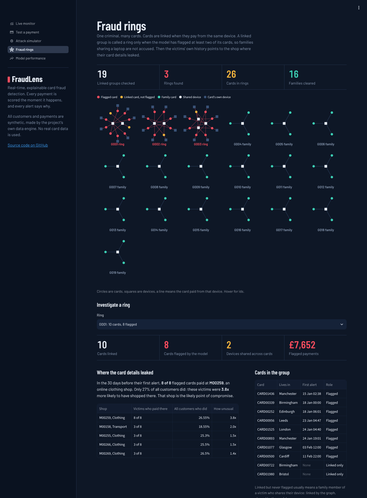
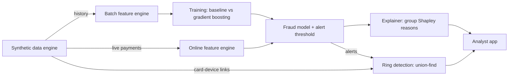

# FraudLens

**Real-time, explainable card fraud detection.**
FraudLens scores every card payment the moment it happens, flags the suspicious ones and
explains *why* each one was flagged, so a fraud analyst can act on it in seconds.

[](https://fraudlens-begum.streamlit.app)


**Live demo: [fraudlens-begum.streamlit.app](https://fraudlens-begum.streamlit.app)**

> Work in progress. See the [roadmap](#roadmap) for what is built so far.

---

## The app

An analyst app (Streamlit) puts the whole system on screen. It needs no data or model
files: on first launch it generates its own bank of 2,000 customers, trains the model and
warms up the live feature engine, which takes about 30 seconds.


| Screen | What it shows |
|---|---|
| **Live monitor** | Unseen payments replayed in time order through the real-time path (online features, model, explanations). A "fraud seismograph" draws every payment as a line whose height is its fraud score on a log scale, so attacks punch through the alert line as red spikes. Alerts queue up with their reasons, next to the ground truth. |
| **Test a payment** | Pick a real customer, describe a new payment (amount, place, time, device) and get the decision and its reasons instantly, from that card's actual history. |
| **Attack simulator** | Launch a fresh card-testing, account-takeover or stolen-card attack on any customer, or let a known fraud ring strike again, and see at which payment it is caught and how much money is saved. |
| **Fraud rings** | Cards linked through shared devices, drawn as a network. Rings are told apart from families sharing a laptop, and each ring's victims point to the shop where their card details leaked. |
| **Model performance** | Baseline vs gradient boosting, and a slider for the false-alarm budget showing how many frauds, pounds and attacks each setting catches. |

<details>
<summary>More screenshots</summary>

**Test a payment**: a night-time jewellery purchase from Lagos on an unknown device


**Attack simulator**: a stolen-card spree, caught on the third payment


**Fraud rings**: every linked group of cards, rings in red, families in teal


**Model performance**


</details>

Risk is shown on a 0-100 scale: the share of genuine payments that look less suspicious.
Raw fraud probabilities are tiny because fraud is rare, so "riskier than 99.95% of genuine
payments" is easier to act on than "score 0.004". Alerts start at 99.9.

```bash
fraudlens-app        # opens http://localhost:8501
```

## Why this project

Card fraud is rare (well under 1% of payments) but expensive, and a bank has only a few
milliseconds to decide whether to approve a payment. That makes it a hard engineering
problem, not just a modelling one:

- **Extreme class imbalance**: a model that says "never fraud" is 99.7% accurate and useless.
- **Time matters**: features such as "how many payments in the last 10 minutes" must be
  computed from the past only, otherwise the model cheats (data leakage).
- **Decisions must be explainable**: analysts and regulators need a reason, not just a score.
- **Latency budget**: scoring has to be fast enough to sit inside a payment flow.

## Architecture



## Roadmap

- [x] **1. Synthetic data engine**: customers with individual habits, UK and foreign merchants,
      three fraud attack types and genuine trips abroad as hard negatives
- [x] **2. Feature engineering**: 24 velocity, habit, location, device and network features,
      computed point-in-time by two engines (batch + online) that are tested to agree
- [x] **3. Modelling**: logistic regression baseline vs gradient boosting; time-based split;
      alert threshold set from a fixed false-alarm budget
- [x] **4. Explainability**: plain-English reason codes from exact Shapley values over
      feature groups; used to find and fix a shortcut the model had learned
- [x] **5. Analyst app**: live monitor, payment tester, attack simulator and model
      performance screens, tested headlessly with Streamlit's AppTest
- [x] **6. Fraud rings**: card-device graph with a hand-written union-find, rings told apart
      from families by model alerts, and the breached shop found from the victims' history
- [ ] **7. Drift monitoring**: detect when a new attack pattern degrades the model
- [ ] **8. Scoring API**: FastAPI service with measured p50 / p99 latency

## The data

Real fraud data is confidential, and public datasets either hide their features (PCA
components) or lack the behaviour patterns needed for real-time features. FraudLens therefore
generates its own data, built around attack patterns that banks actually see:

| Scenario | What happens | Signals a good model should pick up |
|---|---|---|
| `card_testing` | 5–12 tiny online payments seconds apart, then 1–2 big electronics purchases; half appear to be in the UK (VPN) | burst of payments, new device |
| `account_takeover` | 2–4 high-value online purchases between 01:00 and 05:00, mostly from abroad (30% via a UK VPN) | new device, unusual hour, amount far above habit |
| `stolen_card_spree` | 4–8 large in-store purchases in another UK city within a few hours | unusual city, amount far above habit, many shops quickly |
| `legit_travel` *(not fraud)* | a genuine holiday abroad with normal spending | foreign location, but normal hours and amounts |
| fraud rings | 60% of online attacks come from rings: one criminal group attacking about 8 cards from the same 1-3 devices, after buying details stolen from one breached shop that every victim paid at days earlier | a device already seen on other cards |
| shared family devices *(not fraud)* | 4% of customers pay online from a laptop or tablet shared with one or two family members | a shared device that is perfectly innocent |

`legit_travel` and shared family devices exist on purpose: without these hard negatives a
model could simply flag every foreign payment, or every device used by more than one card. The generator is fully reproducible: the same seed always gives the
same dataset, which is checked in the test suite.

Default dataset: **~130,000 transactions**, 2,000 customers, 30 days, **~0.3% fraud**,
3 fraud rings.

### Schema

| Column | Description |
|---|---|
| `transaction_id` | unique id, in time order |
| `timestamp` | when the payment happened |
| `customer_id`, `card_id` | who paid |
| `merchant_id`, `merchant_category`, `merchant_city` | where they paid (`ONLINE` for e-commerce) |
| `channel` | `online` or `in_store` |
| `amount` | GBP |
| `lat`, `lon` | location of the payment |
| `device_id` | device used for online payments (empty in store) |
| `is_fraud`, `fraud_type`, `ring_id` | labels: **never** used as model inputs |

## Features

Every feature for a payment is built **only from that card's earlier payments**. A test
deletes all future data, recomputes everything and checks that no past value changes.

| Group | Examples | Catches |
|---|---|---|
| Velocity | payments in last 10 min / 1 h / 24 h, small payments in last 10 min | card testing bursts |
| Habit | amount ÷ card's average, z-score, how usual this hour is, new category | spending out of character |
| Location | distance from usual place, distance and **travel speed** since last payment | stolen cards, "impossible travel" |
| Device | first use of a device, device first seen < 24 h ago | account takeover |
| Network | how many *other* cards used this device before | fraud rings, from their first payment on a new card |

How strongly some of them separate fraud from genuine payments on the default dataset:

| Feature | Genuine (mean) | Fraud (mean) | Ratio |
|---|---:|---:|---:|
| `small_txn_count_10m` | 0.002 | 1.81 | ~770× |
| `is_outside_uk` | 0.005 | 0.61 | ~120× |
| `txn_count_10m` | 0.03 | 1.84 | ~65× |
| `device_card_count` | 0.02 | 1.25 | ~58× |
| `dist_from_usual_km` | 54 | 1,867 | ~35× |
| `new_device_24h` | 0.03 | 0.67 | ~25× |
| `amount_to_avg_ratio` | 1.10 | 4.70 | ~4× |

No single feature is enough on its own (genuine customers also travel abroad and buy
expensive things), which is why a model that combines them is needed. That is Phase 3.

### Two engines, one definition

| | Batch engine | Online engine |
|---|---|---|
| Used for | building the training set | scoring a live payment |
| How | vectorised pandas over the whole history | small running state per card |
| Speed | ~130k payments in ~4 s | **p50 0.04 ms, p99 0.09 ms per payment** |

Running two implementations of the same logic is a well-known source of
*training/serving skew*. FraudLens guards against it with a parity test that replays a
whole dataset through the online engine and requires every feature to match the batch
engine. The test earned its place on day one: it caught a bug where the online engine
computed `~True` (which is `-2` in Python) instead of `False`.

## Model results

**Setup.** 5,000 customers over 60 days (651,379 payments, 0.15% fraud, 8 fraud rings), split by time:
train on 1 Jan – 8 Feb, choose the alert threshold on 9 – 17 Feb, report on 18 Feb – 1 Mar.
The model never sees the future during training.

**The rule.** Analysts can only review so many alerts and every false alarm blocks a genuine
customer's card. So the threshold is set to allow **at most 1 false alarm per 1,000 genuine
payments** (chosen on the validation weeks), and models are compared at that fixed budget.

Test set (130,510 payments, 173 fraudulent, 29 separate attacks):

| Model | PR-AUC | Fraud payments caught | £ fraud caught | Attacks caught | Alert precision |
|---|---:|---:|---:|---:|---:|
| Logistic regression (baseline) | 0.287 | 63.0% | 66.2% | 22 / 29 | 32% |
| **Gradient boosting** | **0.970** | **98.3%** | **98.7%** | **29 / 29** | **55%** |

- Gradient boosting wins because fraud lives in *combinations* ("far from home **and** a new
  device **and** at night") that a linear model cannot express. The gap is largest on
  stolen-card sprees: 96% caught vs 29% for the baseline.
- Recall by attack type: account takeover 100%, card testing 100%, stolen card spree 95.7%.
- Most useful features (permutation importance): distance from usual location, device first
  seen in the last 24 h, merchant category, amount vs habit, money spent in the last hour.
- Scoring one payment takes about **7 ms** (p50) on a laptop CPU.
- The baseline fell from 0.67 to 0.29 PR-AUC when rings and shared family devices were
  added to the data, while gradient boosting held steady. A likely reason, not yet tested:
  "several cards on one device" is suspicious for a ring but normal for a family, and
  telling them apart needs exactly the kind of combination a linear model cannot learn.

Full numbers are in [`reports/metrics.json`](reports/metrics.json).

**Limitations, honestly.** The data is synthetic, so the attack patterns are cleaner than
real fraud, where criminals adapt to the model. The test set holds only 29 attacks, so
"29 / 29" is encouraging rather than proof. The value of this phase is the evaluation
method (time split, fixed false-alarm budget, money- and attack-level recall), which carries
over unchanged to real data.

## Explainability

Every alert comes with plain-English reasons, ranked by how much of the suspicion each
one carries. A real example from the test period:

```
T0553371  account takeover by a fraud ring  score 0.999
   42%  This device has already been used with 6 other cards
   25%  Paid 258 km from the card's usual area
   18%  Merchant category: digital goods
```

**How.** Features are grouped by meaning (location, velocity, amount, device, timing,
merchant, history). The payment is re-scored for all 2⁷ = 128 mixes of "this group has
its real value" and "this group looks like a typical genuine payment", and each group
receives its exact **Shapley value**: its fair share of the score. Explaining one
payment takes about 9 ms.

Why not simply switch off one signal at a time? Fraud is an *AND* of signals. Making
either "new device" or "abroad" look normal drops the score to almost nothing, so both
would look 99% responsible. Shapley values split the credit fairly, and a unit test
checks exactly this on a model whose answer is known by hand.

**What the explanations revealed.** The first version of the explainer showed that
every card-testing alert was explained by *"paid from abroad + digital goods"*, not by
the burst of tiny payments. The model had learned a shortcut: in the generated data,
card testers were always abroad, so it would have missed any tester using a UK VPN.
The generator was fixed (half of card testers and 30% of account takeovers now appear
in the UK), the model retrained, and the reasons now match the attacks:

| Alert type | Top reason: device | velocity | location | amount |
|---|---:|---:|---:|---:|
| card testing | 32 | **40** | 0 | 0 |
| account takeover | **30** | 0 | 1 | 0 |
| stolen card spree | 0 | 10 | **57** | 0 |
| false alarm (genuine) | 0 | 6 | **128** | 3 |

The last row is useful too: most false alarms are genuine customers spending more
than usual in another UK city, which looks exactly like a stolen-card spree. That
points to the next improvement: features that know about a customer's travel history.

Example explanations are in [`reports/explanations.json`](reports/explanations.json).

## Fraud rings

Criminals rarely attack one card. A ring buys a batch of card details, usually stolen
from one breached shop, and works through them from a handful of devices. FraudLens
looks for that pattern in three steps.

**1. Link cards through devices.** Every online payment links a card to a device. A
**union-find** (disjoint-set) structure, written from scratch with path compression and
union by size, joins these links into groups of cards connected directly or through a
chain of shared devices. It is checked against breadth-first search on random graphs.

**2. Tell rings from families.** Structure alone is not enough: three people sharing a
family laptop form exactly the same shape as a small ring. A group is called a ring only
when the model has flagged at least two of its cards. The graph and the model each catch
what the other misses.

**3. Find the leak.** For each ring, which shop did the victims pay at in the 30 days
before their first alert, far more often than customers in general? That shop is the
likely point of compromise.

Results on the 60-day dataset (8 real rings, 62 victim cards, 35 linked groups):

| | Result |
|---|---|
| Rings found | **8 of 8** |
| Victim cards recovered | **62 of 62** |
| Family groups wrongly called a ring | 1 of 27 |
| Breached shop ranked first | **8 of 8 rings**, checked against the ground truth. 7 or 8 of each ring's flagged cards paid there, **2.8x to 7.7x** more often than customers overall |

The network signal also works in real time. Because a ring's device has already been
seen on other cards, its next attack on a new card is flagged from the very first
payment (try it in the app's attack simulator).

Honest caveats: a ring's group can also pull in a victim's family members, who share
the victim's own device; the app shows them as linked but not flagged. And in real data
rings hide behind fresh devices, so production systems link cards through many more
signals (IP addresses, shipping addresses, emails) than this synthetic one does.

Full report: [`reports/rings.json`](reports/rings.json).

## Quick start

```bash
git clone https://github.com/beggumuzun/fraudlens.git
cd fraudlens
python -m venv .venv && source .venv/bin/activate
pip install -e ".[dev]"

# 1. generate the dataset (the results above use exactly these settings)
fraudlens-generate --customers 5000 --days 60 --out data/transactions.csv

# 2. build features (also prints a fraud-vs-genuine report)
fraudlens-features --input data/transactions.csv --out data/features.csv

# 3. train and compare models (saves models/fraudlens.joblib and reports/metrics.json)
fraudlens-train --features data/features.csv

# 4. explain the alerts on the test period (writes reports/explanations.json)
fraudlens-explain --features data/features.csv

# 5. find fraud rings and the shops their card details leaked from (reports/rings.json)
fraudlens-rings --transactions data/transactions.csv --features data/features.csv

# 6. open the analyst app (builds its own demo world, no files needed)
fraudlens-app

# run tests and lint
pytest -v
ruff check .
```

## Project structure

```
fraudlens/
├── src/fraudlens/
│   ├── data/
│   │   ├── entities.py    # cities, categories, customers, merchants
│   │   ├── scenarios.py   # fraud attacks and genuine travel
│   │   └── generator.py   # builds the dataset, CLI, live replay
│   ├── features/
│   │   ├── definitions.py # feature names, constants, shared maths
│   │   ├── batch.py       # vectorised engine for training + CLI
│   │   └── online.py      # per-payment engine for live scoring
│   ├── model/
│   │   ├── split.py       # train / validation / test by time
│   │   ├── metrics.py     # false-alarm budget, £ recall, attack recall
│   │   └── train.py       # baseline vs gradient boosting, save model + CLI
│   ├── explain/
│   │   ├── reasons.py     # group Shapley values -> plain-English reasons
│   │   └── cli.py         # explain test-period alerts
│   ├── graph/
│   │   ├── union_find.py  # disjoint-set union, written from scratch
│   │   ├── rings.py       # linked groups, rings vs families, point of compromise
│   │   └── cli.py         # ring report
│   └── app/
│       ├── world.py       # demo world: data, model, warmed-up live engine
│       ├── main.py        # navigation and layout
│       └── views/         # live monitor, test a payment, simulator, rings, performance
├── streamlit_app.py       # entry point for Streamlit Community Cloud
├── docs/screenshots/      # images used in this README
├── reports/               # latest metrics, example explanations, ring report
├── tests/                 # pytest suite, run on every push by GitHub Actions
└── pyproject.toml
```

## Author

**Begüm Uzun**, BSc Computer Science, UWE Bristol
[LinkedIn](https://www.linkedin.com/in/beggum-uzun) · [GitHub](https://github.com/beggumuzun)
